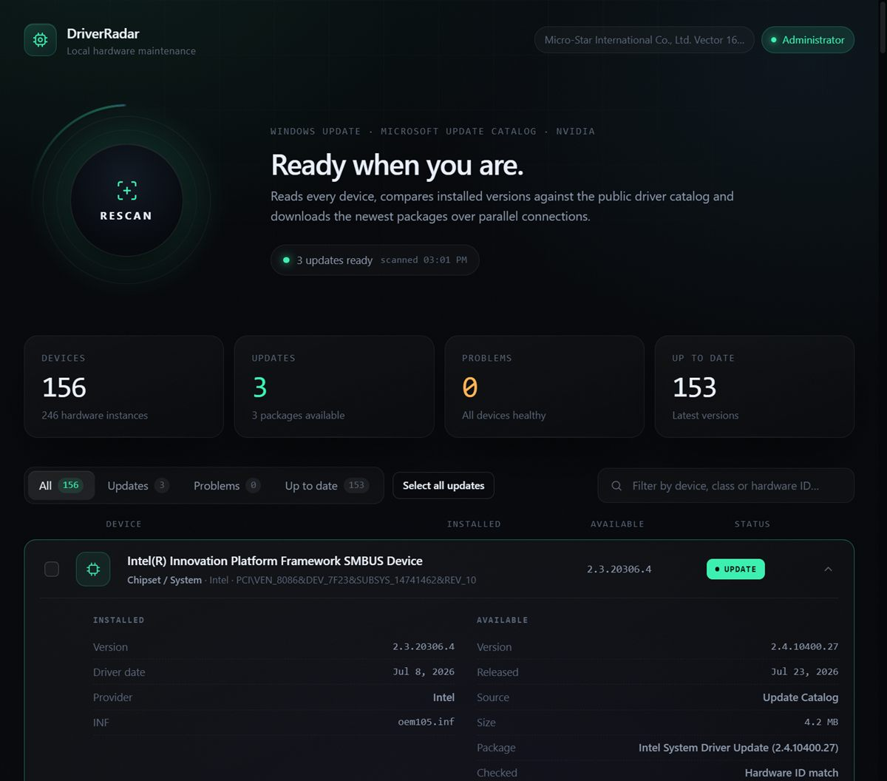

# DriverRadar

**Open-source driver updates for Windows — scan every device, verify against the
Microsoft Update Catalog, download over parallel connections.**

[](#compatibility)
[](https://nodejs.org/)
[](LICENSE)
[](#why-it-is-fast)

DriverRadar is a native desktop app for Windows that inventories every device on the PC,
finds the newest WHQL driver package for each one, and downloads it using multiple HTTP
connections. It runs entirely on your machine, needs no account, has **zero npm
dependencies**, and never uploads anything.

The desktop app is built with [Tauri 2](https://tauri.app/) — the same software Helicon
uses — so it is a real installed application with its own window, its own icon, its own
bundled Node.js runtime and its own updater-free local engine. There is no browser in the
loop. The original portable ZIP and the local web UI are still there for anyone who
prefers them.



## Why it exists

Windows Update is authoritative but slow, opaque, and often returns *nothing* even when a
newer driver exists. OEM utilities are tied to one vendor and one model. DriverRadar fills
the gap:

- **Every device, not a curated list.** It reads the live PnP tree and queries the public
  driver index per hardware ID.
- **Verified matches.** The catalog search is fuzzy, so every candidate package is checked
  against its detail page's `Supported Hardware IDs` before it is offered.
- **Fast.** 16 parallel range requests, resumable shards, packages downloaded two at a time.
- **Transparent.** You see the installed version, the available version, the source, the
  package size, and the raw `pnputil` output. Nothing is hidden behind a progress spinner.
- **Any Windows PC.** No hardcoded model, vendor, or machine ID. Windows 10/11, x64 or ARM64.

## Screenshots

| Scanning | Device detail |
|---|---|
|  |  |

## The desktop app

DriverRadar is a [Tauri 2](https://tauri.app/) application. Tauri draws the window with the
operating system's own web view (WebView2 on Windows, WKWebView on macOS, WebKitGTK on
Linux) and runs a small Rust host, so the download is one installer of about 23 MB rather
than a bundled browser.

```
desktop/src-tauri/         Rust shell: window, splash screen, engine supervision
desktop/splash/            "Starting DriverRadar" screen shown until the engine answers
desktop/src-tauri/resources/app     the Node engine (server.js, lib/, public/, scripts/)
desktop/src-tauri/resources/node    a bundled Node.js runtime
```

The shell starts the engine on `127.0.0.1:7788`, waits for `/api/health`, then shows the
normal UI in the window. It keeps the engine alive — if the server crashes it is restarted
— and stops it when the window closes. The UI is the same file set the browser build
serves, so there is one front end to maintain, not two.

Installed apps cannot write beside themselves, so the desktop build keeps its state in a
per-user folder instead of `data\`:

| OS | Data folder |
|---|---|
| Windows | `%LOCALAPPDATA%\com.driverradar.desktop` |
| macOS | `~/Library/Application Support/com.driverradar.desktop` |
| Linux | `~/.local/share/com.driverradar.desktop` |

The engine log is `desktop.log` in that folder. Downloads and driver backups live under
`downloads\` and `driver-backup\` there, and the UI shows the exact path.

Building it yourself needs the Rust toolchain (`rustup.rs`) and Node 20+:

```bat
powershell -NoProfile -ExecutionPolicy Bypass -File scripts\build-desktop.ps1
```

That stages the engine, downloads a Node runtime, and writes
`dist\DriverRadar-<version>-windows-x64-setup.exe`. `scripts\stage-desktop.js` does the
staging part on its own and accepts `--platform` / `--arch`, which is how the macOS and
Linux builds work in CI.

## Quick start

### Requirements

| | |
|---|---|
| OS | Windows 10 or Windows 11 (x64 or ARM64) |
| Runtime | [Node.js 20+](https://nodejs.org/) — **bundled in the desktop installers**, installed automatically by the portable ZIP on first run |
| PowerShell | 5.1 — included with Windows |
| Rights | Administrator for installing drivers (scanning works without) |
| Disk | about 130 MB installed by the desktop app (mostly the bundled Node.js), 1 MB for the ZIP, plus downloaded packages |

### Install from a release

Every release carries the native desktop app for all three platforms **and** the original
portable files:

| Platform | Asset | What it is |
|---|---|---|
| Windows 10/11 x64 | `DriverRadar_<version>_x64-setup.exe` | **Recommended.** Native desktop installer (Tauri). Installs per user in `%LOCALAPPDATA%\DriverRadar`, needs no administrator rights to install, bundles Node.js, adds Start Menu and Desktop shortcuts, and uninstalls from **Apps & features**. |
| Windows 10/11 x64 | `DriverRadar-<version>-Setup.exe` | The original C# setup wizard. Same app and same first-run behaviour as the ZIP, kept so existing users are not stranded. |
| Windows 10/11 x64 | `DriverRadar-<version>.zip` | **Portable ZIP**, unchanged. Extract anywhere and double-click `start.cmd`. |
| macOS 11+ | `DriverRadar_<version>_x64.dmg`, `DriverRadar_<version>_aarch64.dmg` | Native desktop app for Intel and Apple Silicon. Opens and runs; the driver engine itself needs Windows (see [Compatibility](#compatibility)). |
| Linux x64 | `DriverRadar_<version>_amd64.AppImage` and the matching `.deb` | Native desktop app. Same Windows-engine caveat. |

**Windows desktop app (recommended)**

1. Download `DriverRadar_<version>_x64-setup.exe` from
   [**Releases**](https://github.com/yourbossdonpely/driver-radar/releases/latest).
2. Run it. There is no wizard to click through: it installs for your account, creates the
   shortcuts and finishes.
3. Launch **DriverRadar** from the Start Menu. It opens in its own window — no browser, no
   terminal, no Node.js to install.

The installer is unsigned, so SmartScreen may say "Windows protected your PC": click
**More info**, then **Run anyway**. WebView2 (the window engine) is already part of
Windows 11 and current Windows 10; the installer adds it if a machine is missing it.

**Portable ZIP**

1. Download `DriverRadar-<version>.zip` from
   [**Releases**](https://github.com/yourbossdonpely/driver-radar/releases/latest).
2. Extract it anywhere (for example `C:\Tools\DriverRadar`). Avoid `Program Files` — the
   app writes downloads next to itself.
3. Double-click **`start.cmd`**.

**The older Setup.exe**

The C# wizard (`DriverRadar-<version>-Setup.exe`) still works exactly as before: accept the
agreement, pick a destination, install. It unpacks the app and leaves the first-run work to
`start.cmd`, so the ZIP paragraph below applies to it too.

With the ZIP, that is the whole install. `start.cmd` asks for administrator rights **before** the app
opens, installs Node.js if the machine has no usable runtime, starts the local server on
`http://127.0.0.1:7788`, and opens your browser. The desktop installers skip all of that:
Node.js is inside the installer and the window is the UI.

### First run on a clean PC

A brand-new Windows install has no Node.js, so there is nothing that can run the app yet.
`start.cmd` handles that itself — you do not install anything by hand:

1. It elevates first, because both driver installs and the Node.js install need it.
2. It looks for an existing Node 20+ runtime (PATH, `Program Files\nodejs`, per-user
   installs).
3. If none is found, it installs the official LTS build **silently** — through `winget`
   when available, otherwise by downloading the signed MSI from
   `https://nodejs.org/dist/…` for the machine's CPU (x64, ARM64 or x86).
4. It records the resolved path in `data\node-path.txt` and starts the app.

No prompts, no browser trip, no "install Node and come back". The only requirement is an
internet connection. If the install cannot happen — offline PC, or `winget`/Windows
Installer blocked by policy — the launcher stops with a plain-language message and the
details in `data\bootstrap.log`, instead of failing later with a stack trace.

`requirements.txt` documents everything the app expects from Windows, so a machine that
misbehaves can be checked line by line. There are no package dependencies to install: the
app is plain Node core.

> The server only listens on `127.0.0.1`. There is no cloud component, no account, and no
> telemetry.

### Run from source

```bat
git clone https://github.com/yourbossdonpely/driver-radar.git
cd driver-radar
start.cmd
```

That path works like a release: `start.cmd` elevates, installs Node.js if it is missing,
and opens the browser. With `npm` you can also run it directly:

```bat
npm start               :: same as start.cmd, minus the elevation prompt
node supervisor.js      :: server with crash supervision
node server.js          :: just the server, no supervisor
```

Running this way needs Node.js 20+ already installed — `start.cmd` is what handles a
machine without it. The repository has no dependencies, so there is no `npm install` step.

## Using it

1. Press the big **SCAN** button.
2. Review the list. The tabs split devices into **Updates**, **Problems**, and **Up to date**.
3. Expand a row to see the installed driver, the available package, the catalog link, and
   the verification result.
4. Tick the updates you want, choose **16 connections**, and press **Update selected** —
   or **Download only** to keep the files without installing.
5. Don't need a particular update? Press **Ignore** on its row to hide it from the list.
   Dismissed updates are remembered and can be restored from the row detail.
6. If a package fails, the job panel offers **Retry N failed** for just those items.
7. **Restore from backup** in the toolbar lists earlier snapshots and reinstalls one,
   which is the rollback path if an update goes wrong.
8. **Export report** downloads a CSV of every scanned device (name, class, provider,
   versions, state, hardware ID). Useful for IT inventory.
9. **Backup to:** lets you change where `pnputil /export-driver` writes snapshots —
   point it at a USB drive (`E:\DriverBackup`) so backups survive a drive failure or
   clean Windows install.

Before the first install the app creates an optional System Restore point (on by default) and
runs an optional driver backup (also on by default), and the job reports whether a reboot is
required. Firmware/BIOS packages are intentionally excluded.

### Command line

```bat
node cli.js scan        :: scan and list available updates
node cli.js list        :: scan and list every device
node cli.js download    :: download all available updates, do not install
node cli.js install     :: download + install all available updates (admin)
```

### HTTP API

| Method | Route | Purpose |
|---|---|---|
| GET | `/api/state` | Scan snapshot, admin flag, recent jobs |
| POST | `/api/scan` | Start a scan (returns immediately) |
| GET | `/api/events` | SSE stream of `scan` / `job` / `state` events |
| POST | `/api/install` | `{items:[{rowId}], install, parts, restorePoint, backup}` |
| GET | `/api/backups` | Driver backup snapshots in `data\driver-backup` |
| POST | `/api/restore` | `{id}` — reinstall one snapshot (admin) |
| POST | `/api/cancel` | `{jobId}` |
| POST | `/api/open` | Open the downloads folder |
| POST | `/api/elevate` | Restart the server elevated |
| GET | `/api/health` | Liveness + admin flag |
| GET | `/api/ignored` | List dismissed ("ignored") update row IDs |
| POST | `/api/ignored` | `{rowId}` — hide an update from the list |
| DELETE | `/api/ignored` | `{rowId}` — restore a hidden update |
| GET | `/api/backup-destination` | Current backup folder path |
| POST | `/api/backup-destination` | `{path}` — set custom backup folder |
| GET | `/api/export` | CSV of every scanned device (download) |

## How it works

```
                 ┌──────────────────────────────┐
                 │  Get-PnpDevice + signed      │
                 │  driver metadata (PowerShell)│
                 └──────────────┬───────────────┘
                                │ hardware IDs, versions, class, problem code
        ┌───────────────────────┼────────────────────────┐
        ▼                       ▼                        ▼
 Windows Update          Microsoft Update Catalog     NVIDIA lookup
 (COM, authoritative)    (search → detail verify)     (GPU name → product)
        │                       │                        │
        └───────────────────────┼────────────────────────┘
                                ▼
                 version compare + grouping + scoring
                                ▼
                 local UI (SSE) → downloader → installer
```

### The sources

1. **Windows Update** — the Microsoft Update service (`7971f918-…`) through
   `Microsoft.Update.Session`. Authoritative, but on a healthy machine it often returns
   zero driver offers, and it can take 20+ seconds. DriverRadar gives it a **5-second
   grace period**, publishes the catalog result, then merges any late offer.
2. **Microsoft Update Catalog** — the largest public index of WHQL driver packages. For
   each candidate device it searches by hardware ID, then opens the package detail page.
   Only packages that explicitly list the device's hardware ID are offered.
3. **NVIDIA** — the GeForce driver lookup API. GPU vendors publish faster than the catalog,
   so the marketing version (`621.24`) is mapped to the Windows build (`…2124`) for
   comparison. The OS id is detected (Windows 10 vs 11), not hardcoded. Laptop parts are
   matched inside NVIDIA's `… (Notebooks)` series — the product id selects the notebook
   package — so a mobile GPU (`… Laptop GPU`, `… with Max-Q Design`) gets the notebook
   driver and a desktop GPU does not. A name carrying `Laptop`/`Notebook`/`Mobile`/`Max-Q`
   never falls back to a desktop series: when the notebook series has no such product the
   NVIDIA source stays silent and the catalog result is used instead.
4. **AMD** — the AMD Adrenalin release page and release notes. DriverRadar reads the
   current Adrenalin version from AMD's driver download page, then matches the machine's
   installed driver branch against the `Windows Driver Store Version` values published in
   that release's notes. AMD ships one branch per GPU generation in the same release, so a
   version is only offered as an update when it matches the branch already running.
5. **Intel** — Intel's direct download feeds for Arc/Iris Xe/UHD/HD graphics, Wi-Fi, and
   Bluetooth adapters. CPUs and chipsets are classified as Intel devices so they appear in
   scans; their drivers are resolved through the Microsoft Update Catalog, since Intel does
   not publish a versioned download feed for them.

### Fuzzy search is not a match

Catalog search is full-text. A query for `ACPI\VEN_INTC&DEV_1062` can return a package
that has nothing to do with that device. DriverRadar therefore fetches
`ScopedViewInline.aspx?updateid=…` for every candidate and compares the package's
`Supported Hardware IDs` with the device's IDs (ignoring `&REV_`, case, and matching
`VEN/DEV` + `SUBSYS` pairs). In one scan on the test machine this skipped packages for four
devices and left three genuine updates.

### Version comparison

`32.0.16.2124` vs `32.0.16.1687`: the second is *older* even though it may have a newer
catalog date. Versions are compared as dotted numeric components; anything lower than the
installed build is shown as **"Newer"**, never as an update. No downgrades.

The running Windows release breaks ties: the machine's build decides whether Windows 10 or
Windows 11 is *its* release, and at an equal version a package naming the running release
ranks above one naming only the other. Nothing is hardcoded to 10 or 11.

### Why it is fast

- **Persisted last scan** — the UI paints the previous result instantly on startup.
- **Cached catalog lookups** — searches and detail pages are cached for 12 hours.
- **Parallel, cached queries** — eight catalog lookups at a time.
- **Multi-part downloads** — 16 range requests in the UI by default (12 if the API omits
  `parts`), 1 MB minimum shard, resumable per shard, with an EMA speed display. Measured on
  the Microsoft CDN: a 35.8 MB package took 17.5 s with 8 streams and **7.4 s with 16**
  (≈4.8 MB/s).
- **Parallel packages** — two packages download at once while installing (three for
  download-only), and installs themselves stay sequential, so `pnputil` and vendor setup
  programs never race.

## Safety model

- **Scanning is read-only.** It only reads device metadata and public catalog pages.
- **Nothing installs without explicit selection.** A confirmation lists every package and
  its size.
- **No downgrades** and no firmware/BIOS flashing.
- **Optional restore point** before the first install.
- **Exported driver backup.** `pnputil /export-driver *` writes every third-party driver
  package to `data\driver-backup\<timestamp>\` first, so a bad update can be rolled back
  even when System Restore is disabled on the machine.
- **Restore is explicit.** A snapshot is only reinstalled when you pick it and confirm a
  dialog that names it; it needs the same administrator rights as an install, runs through
  the same `pnputil` path, and streams into the same job panel.
- **Signed drivers only** — `pnputil` enforces Windows driver signing; unsigned packages
  fail loudly.
- **Local only** — binds `127.0.0.1`, validates the `Host` header, path-traversal checks
  static files.
- **Full transcripts** — the exact `pnputil`/Windows Update output is shown in the job panel.
- **No silent third-party wizards.** NVIDIA uses its documented `-s -noreboot`; other
  vendor `.exe` files are downloaded but never auto-run.

> Driver changes can break a machine. Keep the restore-point toggle on for the first run,
> and reboot when the job says so. Use at your own risk — see the license.

## Compatibility

DriverRadar has no machine-specific assumptions:

- **Any OEM** — Dell, HP, Lenovo, ASUS, Acer, MSI, Microsoft Surface, custom builds.
- **Windows 10 and 11**, x64 and ARM64. Package selection is driven by hardware IDs.
- **Any device class** the catalog carries: chipset, network, Bluetooth, audio, display,
  storage, camera, HID, USB4, and more.
- **OEM builds newer than the public release** are detected and shown as *installed is
  newer*, not as an update.
- **No OEM software required.** Where a vendor blocks scripted access (Intel and some OEM
  pages return 403), the catalog carries the same WHQL packages Microsoft distributes.

Tested on Windows 11 (build 26300) x64 — 157 rows covering 248 device instances — and on a
clean Windows Sandbox with no Node.js and no `winget`, where `start.cmd` installed the
runtime by itself and served the app. Windows 10 and ARM64 are supported by design; reports
from those machines are very welcome.

## Troubleshooting

| Symptom | Fix |
|---|---|
| "The local server stopped" banner | The supervisor restarts the server automatically; press **Retry now** or wait a few seconds. If it stays down, rerun `start.cmd`. |
| `Failed to fetch` when starting a job | The server process is gone. `start.cmd` + `supervisor.js` keep it alive; restart the launcher once. In the desktop app the shell restarts it for you, and the window reconnects on its own. |
| Desktop app says "DriverRadar could not start" | Read `desktop.log` in the data folder listed under [The desktop app](#the-desktop-app). Reinstalling keeps downloads and backups. |
| macOS or Linux build opens but cannot scan | Expected: the driver engine drives PowerShell and `pnputil`, which are Windows components. Use a Windows PC for driver updates. |
| macOS says the app is damaged or from an unidentified developer | The DMG is not notarized. Right-click the app → **Open**, or run `xattr -dr com.apple.quarantine /Applications/DriverRadar.app`. |
| "Could not prepare Node.js" | The one-time install needs internet. Check the connection and rerun `start.cmd`; details are in `data\bootstrap.log`. Last resort: install the LTS MSI from [nodejs.org](https://nodejs.org/) manually. |
| Pill says **Standard user** | The app was started without elevation. Close it and run `start.cmd` again — it elevates before opening. |
| No updates found | The machine may already be current. Check the **Problems** tab and the notes under the list; OEM builds can be newer than the public catalog. |
| Port 7788 already in use | Another instance is running. `start.cmd` reuses it (and restarts it elevated if needed). |
| Antivirus flags `pnputil` | It is the official Windows driver installer. The app calls it directly; review `scripts/install-inf.ps1`. |
| "Driver backup skipped" note | `pnputil /export-driver` needs administrator rights and a writable `data\` folder. The install still proceeds; check the note for the reason. |

## Project layout

```
driver-radar/
├─ server.js              HTTP server, static files, JSON API, SSE
├─ supervisor.js          keeps the server alive, restarts it after a crash
├─ cli.js                 terminal front end
├─ check-nvidia.js        on-demand check of the NVIDIA GPU matcher
├─ installer/
│  └─ setup.cs            setup wizard, launcher and uninstaller, compiled into
│                         DriverRadar-<version>-Setup.exe by the build script
├─ start.cmd              launcher: elevates, installs Node, opens the browser
├─ requirements.txt       what the app needs from Windows (no packages)
├─ desktop/
│  ├─ src-tauri/          Tauri 2 shell (Rust) + platform bundler configuration
│  ├─ splash/             startup screen shown before the engine answers
│  └─ package.json        the Tauri CLI, kept out of the app's zero-dependency tree
│
├─ lib/
│  ├─ scan.js             inventory → sources → merge → grouped rows
│  ├─ catalog.js          Update Catalog search, detail verification, download links
│  ├─ nvidia.js           GPU product matching and WHQL lookup
│  ├─ downloader.js       multi-part HTTP Range downloader
│  ├─ installer.js        CAB extraction, INF matching, pnputil, vendor installers
│  ├─ jobs.js             queue, parallel downloads, sequential installs, restores,
│  │                      progress
│  ├─ backup.js           driver backup snapshots: list, validate, path guard
│  ├─ ps.js               PowerShell runner (script → UTF-8 JSON → object)
│  ├─ admin.js            elevation check
│  ├─ bus.js              SSE fan-out
│  └─ util.js             version compare, formatting, bounded concurrency
│
├─ scripts/               inventory, WU search/install, pnputil, restore point,
│                         driver backup export, bootstrap (installs Node.js
│                         on first run), publish (release to GitHub)
├─ public/                UI (HTML, CSS, JS — no build step)
├─ docs/                  screenshots
└─ data/                  runtime cache + downloads (git-ignored)
```

## Design decisions

- **Zero dependencies.** Everything is Node core, PowerShell and Windows. No supply chain,
  no `npm install`, no build step.
- **Bootstraps itself.** The one thing the app genuinely needs — a Node runtime — is
  installed by `start.cmd` on first launch, so a fresh Windows install works without the
  user reading a README first.
- **Local web UI, native shell.** The UI is plain HTML/CSS/JS served over SSE, so it can
  run in a browser *or* inside a window. Tauri supplies the window, the installer, the icon
  and the bundled runtime without adding a front-end build step or a second UI to maintain.
- **The engine stays Node.** PowerShell, `pnputil` and the Update COM API are the actual
  work; rewriting them in Rust would add risk and change nothing the user sees.
- **A supervisor process.** The browser cannot start a process, so a small Node supervisor
  watches `/api/health` and relaunches the server. That is what makes **Retry now** real.
- **PowerShell for Windows APIs.** `Get-PnpDevice`, `pnputil`, `Checkpoint-Computer` and the
  Update COM API are already there; no drivers or native modules are needed.
- **Verification over guessing.** A fuzzy search hit is never enough; the detail page must
  list the hardware ID.

## Limitations

- **Firmware/BIOS is out of scope.** Only Windows driver packages are offered.
- **Windows-only engine, by design.** The engine is `pnputil`, PnP enumeration, the Windows
  Update COM API and PowerShell INF installs, so scanning and installing only happen on
  Windows. The macOS and Linux desktop builds exist and start normally, but they say that
  plainly instead of failing halfway through a PowerShell call: they are useful for reading
  the UI and for the project's packaging, not for updating drivers. A real port would mean
  `udev`, `modprobe` and each vendor's Linux tooling — a different program.
- **Vendor direct APIs.** AMD (Adrenalin) and Intel (graphics, Wi-Fi, Bluetooth) are
  queried directly where their sites permit automated access; CPUs, chipsets, and every
  other device class fall back to the Microsoft Update Catalog. Vendors that block
  automated clients (some OEM pages return 403) are still covered by the catalog's WHQL
  packages.
- **Catalog availability.** A very old package can disappear; rescanning refreshes links.
- **Grouping** merges rows by hardware ID + name, so identical devices show one row with an
  instance count.
- **No scheduled background service** by default. The app runs while `start.cmd` (and the
  supervisor) is open. Adding a logon task is a planned option.

## FAQ

**Does it send my data anywhere?**
No. It makes the same public requests a browser would (Microsoft Update, Update Catalog,
NVIDIA) and binds to `127.0.0.1`. There is no analytics or account.

**Why does it need administrator rights?**
`pnputil /add-driver /install` and Windows Update installation require elevation. Scanning
would work without it, but starting elevated avoids failing halfway through an update.

**Is the Microsoft Update Catalog the largest driver database?**
It is the largest public index of WHQL-signed Windows drivers, and it is what Windows
itself uses. DriverRadar queries it per hardware ID and verifies every package.

**Will it install the wrong driver?**
A package is only offered when its detail page lists the device's hardware ID and its
version is newer. The INF is checked again after extraction, and `pnputil` enforces signing.

**Does it work on Windows 10 / ARM64?**
Yes by design: device matching is hardware-ID based and the app has no x64-only code. The
test machine is Windows 11 x64; other reports are welcome.

## Releasing

Bump the version in `package.json` and `server.js`, build the ZIP from the committed tree, then
publish it with `scripts/publish.ps1` (it derives the tag, asset and release notes from
`package.json`, and refuses to run if `server.js` disagrees):

```bat
git archive --format=zip -o dist\DriverRadar-<version>.zip --prefix=DriverRadar-<version>/ HEAD
powershell -NoProfile -ExecutionPolicy Bypass -File scripts\publish.ps1
```

`-DryRun` prints the version, tag, asset and notes paths without touching GitHub. Notes come
from `data\release-notes-<version>.md` (git-ignored). Requires an authenticated `gh`.

A release carries the portable `DriverRadar-<version>.zip`, the
`DriverRadar-<version>-Setup.exe` wizard, and the native installers for Windows, macOS and
Linux.

### The desktop installers

The Tauri installers are built by
[`.github/workflows/desktop-release.yml`](.github/workflows/desktop-release.yml) when a tag
is pushed. Tauri links against the host platform, so a DMG cannot be produced on Windows:
the workflow runs four jobs and attaches everything to the same GitHub Release.

| Runner | Bundle | Asset |
|---|---|---|
| `windows-latest` | NSIS | `DriverRadar_<version>_x64-setup.exe` |
| `macos-13` | DMG (x64) | `DriverRadar_<version>_x64.dmg` |
| `macos-14` | DMG (arm64) | `DriverRadar_<version>_aarch64.dmg` |
| `ubuntu-22.04` | AppImage + deb | `.AppImage` and `.deb` |

Windows can also build locally, without CI:

```bat
powershell -NoProfile -ExecutionPolicy Bypass -File scripts\build-desktop.ps1
```

The usual sequence for a release:

```bat
:: 1. bump package.json and server.js, then build the portable assets
git archive --format=zip -o dist\DriverRadar-<version>.zip --prefix=DriverRadar-<version>/ HEAD
powershell -NoProfile -ExecutionPolicy Bypass -File scripts\build-installer.ps1
powershell -NoProfile -ExecutionPolicy Bypass -File scripts\build-desktop.ps1

:: 2. push main and create the release with the Windows assets
powershell -NoProfile -ExecutionPolicy Bypass -File scripts\publish.ps1

:: 3. tag it so CI builds the macOS and Linux installers onto the same release
git tag v<version>
git push origin v<version>
```

### The installer wizard

Before the Tauri app existed, a release carried two assets: the portable
`DriverRadar-<version>.zip` and the `DriverRadar-<version>-Setup.exe` wizard. Both are still
built and still work.

  ```bat
  powershell -NoProfile -ExecutionPolicy Bypass -File scripts\build-installer.ps1
  powershell -NoProfile -ExecutionPolicy Bypass -File scripts\build-installer.ps1 -Commit 6be33a3
  ```

  Writes `dist\DriverRadar-<version>-Setup.exe`. It is C# (`installer\setup.cs`) compiled with
  the .NET Framework `csc.exe` that ships with Windows, with the app embedded as a ZIP
  resource — no Inno Setup, no NSIS, no downloads, and the same version guard as the publish
  script. The EXE behaves as its own launcher and uninstaller:

  | Invocation | Effect |
  |---|---|
  | `DriverRadar-<version>-Setup.exe` | setup wizard (folder, shortcuts, progress, finish) |
  | `… -Setup.exe --silent` | same install, no UI |
  | `… -Setup.exe --extract <dir>` | unpack the payload only (used to verify a build) |
  | `<install>\DriverRadar.exe --uninstall [--silent]` | remove the app, shortcuts and its registry entry |

  The wizard guides the user through standard Windows setup steps:
  1. **License Agreement**: Shows the MIT License terms and requires **I accept the agreement** before continuing.
  2. **Destination & Shortcuts**: Configures install path (default `%LOCALAPPDATA%\DriverRadar`, no admin required) with **Browse…**, Desktop shortcut toggle, and developer info (`yourbossdonpely`).
  3. **Installation**: Displays a progress bar while extracting files, creating shortcuts, and registering the app.
  4. **Completion**: Offers a **Launch DriverRadar now** checkbox and **Finish** button.

  The application icon is `appicon.png`, embedded directly into the EXE, header panel, shortcuts, and **Apps & features**.

  **Signing.** After compilation the build signs the EXE with `signtool.exe` using the
  code-signing certificate in `driverradar.pfx` (password `DriverRadar2026!`), hashed with
  SHA256 and stamped at `http://timestamp.digicert.com`. The certificate subject is
  `CN=yourbossdonpely, O=DriverRadar`. If needed, `scripts\ensure-cert.ps1` creates the PFX
  and imports the certificate into the CurrentUser `TrustedPublisher` store. Verify a build with:

  ```bat
  Get-AuthenticodeSignature -FilePath dist\DriverRadar-1.3.3-Setup.exe
  ```

  ### npm

`package.json` exposes `cli.js` as a `bin` and a `files` allowlist, so the package is
installable without a clone:

```bat
npm pack                 :: builds driver-radar-<version>.tgz
npx driver-radar list    :: run the CLI from the package
```

Publishing is `npm publish` and needs an npm login on the machine. The package is
Windows-only like the app: `driver-radar scan` shells out to PowerShell.

## Contributing

Issues and pull requests are welcome. See [CONTRIBUTING.md](CONTRIBUTING.md). Good first
contributions: vendor adapters, Windows 10/ARM64 test reports, UI polish, and translations.

Changed the NVIDIA matching? `node check-nvidia.js` asserts the laptop, desktop and
unknown-device rules against the live lookup and exits non-zero on a mismatch.

## License

[MIT](LICENSE). DriverRadar is not affiliated with Microsoft or NVIDIA. Driver packages
remain the property of their publishers; the app only downloads them for the local machine.
