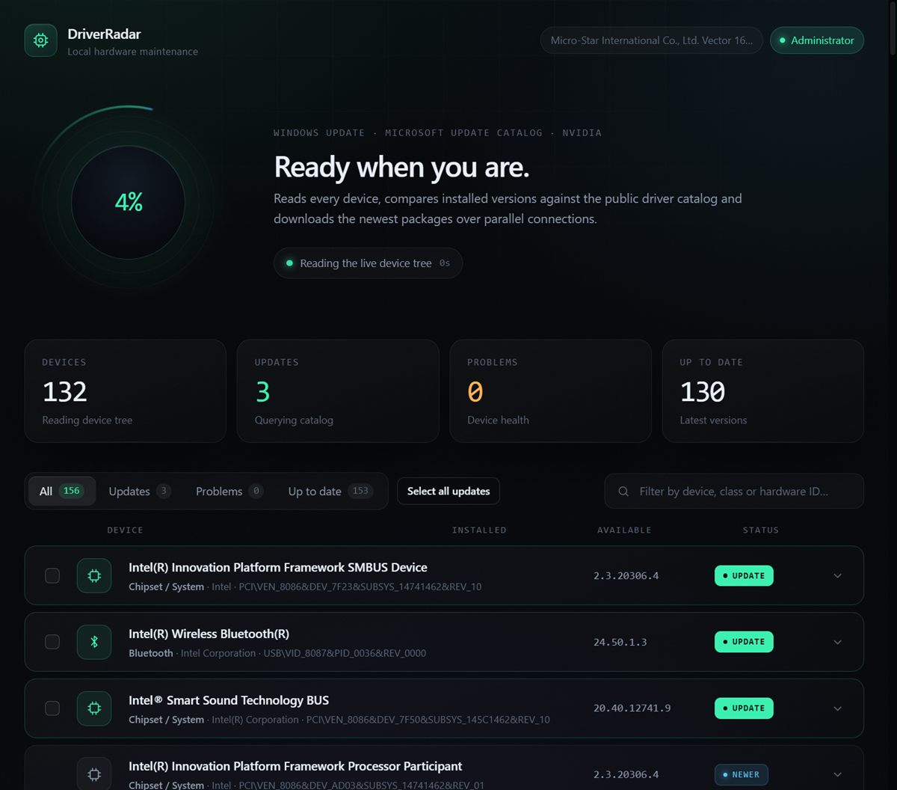
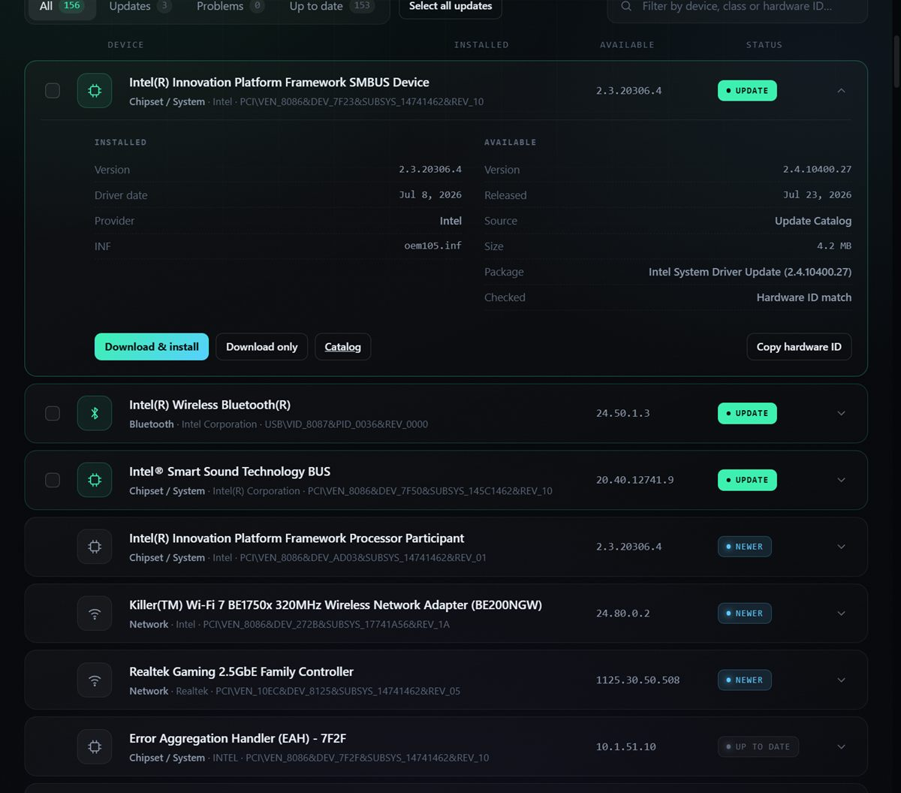

# DriverRadar

**Open-source driver updates for Windows — scan every device, verify against the
Microsoft Update Catalog, download over parallel connections.**

[](#compatibility)
[](https://nodejs.org/)
[](LICENSE)
[](#why-it-is-fast)

DriverRadar is a local web app that inventories every device on a Windows PC, finds the
newest WHQL driver package for each one, and downloads it using multiple HTTP connections.
It runs entirely on your machine, needs no account, has **zero npm dependencies**, and
never uploads anything.


## Why it exists

Windows Update is authoritative but slow, opaque, and often returns *nothing* even when a
newer driver exists. OEM utilities are tied to one vendor and one model. DriverRadar fills
the gap:

- **Every device, not a curated list.** It reads the live PnP tree and queries the public
  driver index per hardware ID.
- **Verified matches.** The catalog search is fuzzy, so every candidate package is checked
  against its detail page's `Supported Hardware IDs` before it is offered.
- **Fast.** 16 parallel range requests, resumable shards, packages downloaded two at a time.
- **Transparent.** You see the installed version, the available version, the source, the
  package size, and the raw `pnputil` output. Nothing is hidden behind a progress spinner.
- **Any Windows PC.** No hardcoded model, vendor, or machine ID. Windows 10/11, x64 or ARM64.

## Screenshots

| Scanning | Device detail |
|---|---|
|  |  |

## Quick start

### Requirements

| | |
|---|---|
| OS | Windows 10 or Windows 11 (x64 or ARM64) |
| Runtime | [Node.js 20+](https://nodejs.org/) — **installed automatically on first run** |
| PowerShell | 5.1 — included with Windows |
| Rights | Administrator for installing drivers (scanning works without) |
| Disk | about 1 MB for the app (the release ZIP is 0.3 MB), plus downloaded packages |

### Install from a release

1. Download `DriverRadar-1.2.0.zip` from
   [**Releases**](https://github.com/yourbossdonpely/driver-radar/releases/latest).
2. Extract it anywhere (for example `C:\Tools\DriverRadar`). Avoid `Program Files` — the
   app writes downloads next to itself.
3. Double-click **`start.cmd`**.

That is the whole install. `start.cmd` asks for administrator rights **before** the app
opens, installs Node.js if the machine has no usable runtime, starts the local server on
`http://127.0.0.1:7788`, and opens your browser.

### First run on a clean PC

A brand-new Windows install has no Node.js, so there is nothing that can run the app yet.
`start.cmd` handles that itself — you do not install anything by hand:

1. It elevates first, because both driver installs and the Node.js install need it.
2. It looks for an existing Node 20+ runtime (PATH, `Program Files\nodejs`, per-user
   installs).
3. If none is found, it installs the official LTS build **silently** — through `winget`
   when available, otherwise by downloading the signed MSI from
   `https://nodejs.org/dist/…` for the machine's CPU (x64, ARM64 or x86).
4. It records the resolved path in `data\node-path.txt` and starts the app.

No prompts, no browser trip, no "install Node and come back". The only requirement is an
internet connection. If the install cannot happen — offline PC, or `winget`/Windows
Installer blocked by policy — the launcher stops with a plain-language message and the
details in `data\bootstrap.log`, instead of failing later with a stack trace.

`requirements.txt` documents everything the app expects from Windows, so a machine that
misbehaves can be checked line by line. There are no package dependencies to install: the
app is plain Node core.

> The server only listens on `127.0.0.1`. There is no cloud component, no account, and no
> telemetry.

### Run from source

```bat
git clone https://github.com/yourbossdonpely/driver-radar.git
cd driver-radar
start.cmd
```

That path works like a release: `start.cmd` elevates, installs Node.js if it is missing,
and opens the browser. With `npm` you can also run it directly:

```bat
npm start               :: same as start.cmd, minus the elevation prompt
node supervisor.js      :: server with crash supervision
node server.js          :: just the server, no supervisor
```

Running this way needs Node.js 20+ already installed — `start.cmd` is what handles a
machine without it. The repository has no dependencies, so there is no `npm install` step.

## Using it

1. Press the big **SCAN** button.
2. Review the list. The tabs split devices into **Updates**, **Problems**, and **Up to date**.
3. Expand a row to see the installed driver, the available package, the catalog link, and
   the verification result.
4. Tick the updates you want, choose **16 connections**, and press **Update selected** —
   or **Download only** to keep the files without installing.
5. If a package fails, the job panel offers **Retry N failed** for just those items.

Before the first install the app creates an optional System Restore point (on by default) and
runs an optional driver backup (also on by default), and the job reports whether a reboot is
required. Firmware/BIOS packages are intentionally excluded.

### Command line

```bat
node cli.js scan        :: scan and list available updates
node cli.js list        :: scan and list every device
node cli.js download    :: download all available updates, do not install
node cli.js install     :: download + install all available updates (admin)
```

### HTTP API

| Method | Route | Purpose |
|---|---|---|
| GET | `/api/state` | Scan snapshot, admin flag, recent jobs |
| POST | `/api/scan` | Start a scan (returns immediately) |
| GET | `/api/events` | SSE stream of `scan` / `job` / `state` events |
| POST | `/api/install` | `{items:[{rowId}], install, parts, restorePoint, backup}` |
| POST | `/api/cancel` | `{jobId}` |
| POST | `/api/open` | Open the downloads folder |
| POST | `/api/elevate` | Restart the server elevated |
| GET | `/api/health` | Liveness + admin flag |

## How it works

```
                 ┌──────────────────────────────┐
                 │  Get-PnpDevice + signed      │
                 │  driver metadata (PowerShell)│
                 └──────────────┬───────────────┘
                                │ hardware IDs, versions, class, problem code
        ┌───────────────────────┼────────────────────────┐
        ▼                       ▼                        ▼
 Windows Update          Microsoft Update Catalog     NVIDIA lookup
 (COM, authoritative)    (search → detail verify)     (GPU name → product)
        │                       │                        │
        └───────────────────────┼────────────────────────┘
                                ▼
                 version compare + grouping + scoring
                                ▼
                 local UI (SSE) → downloader → installer
```

### The three sources

1. **Windows Update** — the Microsoft Update service (`7971f918-…`) through
   `Microsoft.Update.Session`. Authoritative, but on a healthy machine it often returns
   zero driver offers, and it can take 20+ seconds. DriverRadar gives it a **5-second
   grace period**, publishes the catalog result, then merges any late offer.
2. **Microsoft Update Catalog** — the largest public index of WHQL driver packages. For
   each candidate device it searches by hardware ID, then opens the package detail page.
   Only packages that explicitly list the device's hardware ID are offered.
3. **NVIDIA** — the GeForce driver lookup API. GPU vendors publish faster than the catalog,
   so the marketing version (`621.24`) is mapped to the Windows build (`…2124`) for
   comparison. The OS id is detected (Windows 10 vs 11), not hardcoded.

### Fuzzy search is not a match

Catalog search is full-text. A query for `ACPI\VEN_INTC&DEV_1062` can return a package
that has nothing to do with that device. DriverRadar therefore fetches
`ScopedViewInline.aspx?updateid=…` for every candidate and compares the package's
`Supported Hardware IDs` with the device's IDs (ignoring `&REV_`, case, and matching
`VEN/DEV` + `SUBSYS` pairs). In one scan on the test machine this skipped packages for four
devices and left three genuine updates.

### Version comparison

`32.0.16.2124` vs `32.0.16.1687`: the second is *older* even though it may have a newer
catalog date. Versions are compared as dotted numeric components; anything lower than the
installed build is shown as **"Newer"**, never as an update. No downgrades.

The running Windows release breaks ties: the machine's build decides whether Windows 10 or
Windows 11 is *its* release, and at an equal version a package naming the running release
ranks above one naming only the other. Nothing is hardcoded to 10 or 11.

### Why it is fast

- **Persisted last scan** — the UI paints the previous result instantly on startup.
- **Cached catalog lookups** — searches and detail pages are cached for 12 hours.
- **Parallel, cached queries** — eight catalog lookups at a time.
- **Multi-part downloads** — 16 range requests in the UI by default (12 if the API omits
  `parts`), 1 MB minimum shard, resumable per shard, with an EMA speed display. Measured on
  the Microsoft CDN: a 35.8 MB package took 17.5 s with 8 streams and **7.4 s with 16**
  (≈4.8 MB/s).
- **Parallel packages** — two packages download at once while installing (three for
  download-only), and installs themselves stay sequential, so `pnputil` and vendor setup
  programs never race.

## Safety model

- **Scanning is read-only.** It only reads device metadata and public catalog pages.
- **Nothing installs without explicit selection.** A confirmation lists every package and
  its size.
- **No downgrades** and no firmware/BIOS flashing.
- **Optional restore point** before the first install.
- **Exported driver backup.** `pnputil /export-driver *` writes every third-party driver
  package to `data\driver-backup\<timestamp>\` first, so a bad update can be rolled back
  even when System Restore is disabled on the machine.
- **Signed drivers only** — `pnputil` enforces Windows driver signing; unsigned packages
  fail loudly.
- **Local only** — binds `127.0.0.1`, validates the `Host` header, path-traversal checks
  static files.
- **Full transcripts** — the exact `pnputil`/Windows Update output is shown in the job panel.
- **No silent third-party wizards.** NVIDIA uses its documented `-s -noreboot`; other
  vendor `.exe` files are downloaded but never auto-run.

> Driver changes can break a machine. Keep the restore-point toggle on for the first run,
> and reboot when the job says so. Use at your own risk — see the license.

## Compatibility

DriverRadar has no machine-specific assumptions:

- **Any OEM** — Dell, HP, Lenovo, ASUS, Acer, MSI, Microsoft Surface, custom builds.
- **Windows 10 and 11**, x64 and ARM64. Package selection is driven by hardware IDs.
- **Any device class** the catalog carries: chipset, network, Bluetooth, audio, display,
  storage, camera, HID, USB4, and more.
- **OEM builds newer than the public release** are detected and shown as *installed is
  newer*, not as an update.
- **No OEM software required.** Where a vendor blocks scripted access (Intel and some OEM
  pages return 403), the catalog carries the same WHQL packages Microsoft distributes.

Tested on Windows 11 (build 26300) x64 — 157 rows covering 248 device instances — and on a
clean Windows Sandbox with no Node.js and no `winget`, where `start.cmd` installed the
runtime by itself and served the app. Windows 10 and ARM64 are supported by design; reports
from those machines are very welcome.

## Troubleshooting

| Symptom | Fix |
|---|---|
| "The local server stopped" banner | The supervisor restarts the server automatically; press **Retry now** or wait a few seconds. If it stays down, rerun `start.cmd`. |
| `Failed to fetch` when starting a job | The server process is gone. `start.cmd` + `supervisor.js` keep it alive; restart the launcher once. |
| "Could not prepare Node.js" | The one-time install needs internet. Check the connection and rerun `start.cmd`; details are in `data\bootstrap.log`. Last resort: install the LTS MSI from [nodejs.org](https://nodejs.org/) manually. |
| Pill says **Standard user** | The app was started without elevation. Close it and run `start.cmd` again — it elevates before opening. |
| No updates found | The machine may already be current. Check the **Problems** tab and the notes under the list; OEM builds can be newer than the public catalog. |
| Port 7788 already in use | Another instance is running. `start.cmd` reuses it (and restarts it elevated if needed). |
| Antivirus flags `pnputil` | It is the official Windows driver installer. The app calls it directly; review `scripts/install-inf.ps1`. |
| "Driver backup skipped" note | `pnputil /export-driver` needs administrator rights and a writable `data\` folder. The install still proceeds; check the note for the reason. |

## Project layout

```
driver-radar/
├─ server.js              HTTP server, static files, JSON API, SSE
├─ supervisor.js          keeps the server alive, restarts it after a crash
├─ cli.js                 terminal front end
├─ start.cmd              launcher: elevates, installs Node, opens the browser
├─ requirements.txt       what the app needs from Windows (no packages)
│
├─ lib/
│  ├─ scan.js             inventory → sources → merge → grouped rows
│  ├─ catalog.js          Update Catalog search, detail verification, download links
│  ├─ nvidia.js           GPU product matching and WHQL lookup
│  ├─ downloader.js       multi-part HTTP Range downloader
│  ├─ installer.js        CAB extraction, INF matching, pnputil, vendor installers
│  ├─ jobs.js             queue, parallel downloads, sequential installs, progress
│  ├─ ps.js               PowerShell runner (script → UTF-8 JSON → object)
│  ├─ admin.js            elevation check
│  ├─ bus.js              SSE fan-out
│  └─ util.js             version compare, formatting, bounded concurrency
│
├─ scripts/               inventory, WU search/install, pnputil, restore point,
│                         driver backup export, bootstrap (installs Node.js
│                         on first run)
├─ public/                UI (HTML, CSS, JS — no build step)
├─ docs/                  screenshots
└─ data/                  runtime cache + downloads (git-ignored)
```

## Design decisions

- **Zero dependencies.** Everything is Node core, PowerShell and Windows. No supply chain,
  no `npm install`, no build step.
- **Bootstraps itself.** The one thing the app genuinely needs — a Node runtime — is
  installed by `start.cmd` on first launch, so a fresh Windows install works without the
  user reading a README first.
- **Local web UI.** A browser is the most portable UI on Windows and lets the app stream
  progress over SSE without a native toolkit.
- **A supervisor process.** The browser cannot start a process, so a small Node supervisor
  watches `/api/health` and relaunches the server. That is what makes **Retry now** real.
- **PowerShell for Windows APIs.** `Get-PnpDevice`, `pnputil`, `Checkpoint-Computer` and the
  Update COM API are already there; no drivers or native modules are needed.
- **Verification over guessing.** A fuzzy search hit is never enough; the detail page must
  list the hardware ID.

## Limitations

- **Firmware/BIOS is out of scope.** Only Windows driver packages are offered.
- **Intel/AMD/OEM direct APIs are not used.** Several block automated clients; the catalog
  covers their WHQL packages. Vendor adapters can be added behind the same interface.
- **Catalog availability.** A very old package can disappear; rescanning refreshes links.
- **Grouping** merges rows by hardware ID + name, so identical devices show one row with an
  instance count.
- **No scheduled background service** by default. The app runs while `start.cmd` (and the
  supervisor) is open. Adding a logon task is a planned option.

## FAQ

**Does it send my data anywhere?**
No. It makes the same public requests a browser would (Microsoft Update, Update Catalog,
NVIDIA) and binds to `127.0.0.1`. There is no analytics or account.

**Why does it need administrator rights?**
`pnputil /add-driver /install` and Windows Update installation require elevation. Scanning
would work without it, but starting elevated avoids failing halfway through an update.

**Is the Microsoft Update Catalog the largest driver database?**
It is the largest public index of WHQL-signed Windows drivers, and it is what Windows
itself uses. DriverRadar queries it per hardware ID and verifies every package.

**Will it install the wrong driver?**
A package is only offered when its detail page lists the device's hardware ID and its
version is newer. The INF is checked again after extraction, and `pnputil` enforces signing.

**Does it work on Windows 10 / ARM64?**
Yes by design: device matching is hardware-ID based and the app has no x64-only code. The
test machine is Windows 11 x64; other reports are welcome.

## Contributing

Issues and pull requests are welcome. See [CONTRIBUTING.md](CONTRIBUTING.md). Good first
contributions: vendor adapters, Windows 10/ARM64 test reports, UI polish, and translations.

## License

[MIT](LICENSE). DriverRadar is not affiliated with Microsoft or NVIDIA. Driver packages
remain the property of their publishers; the app only downloads them for the local machine.
